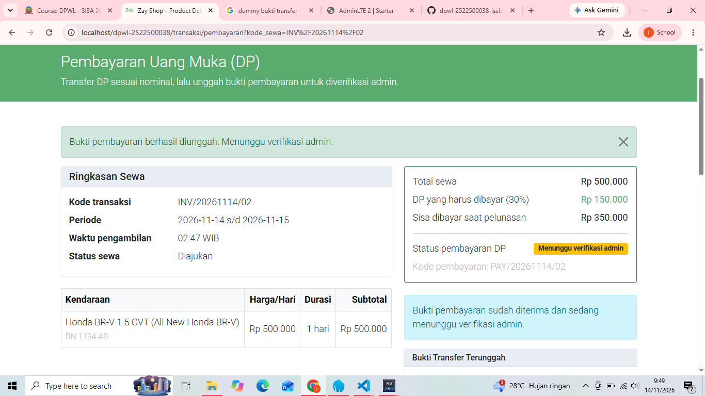
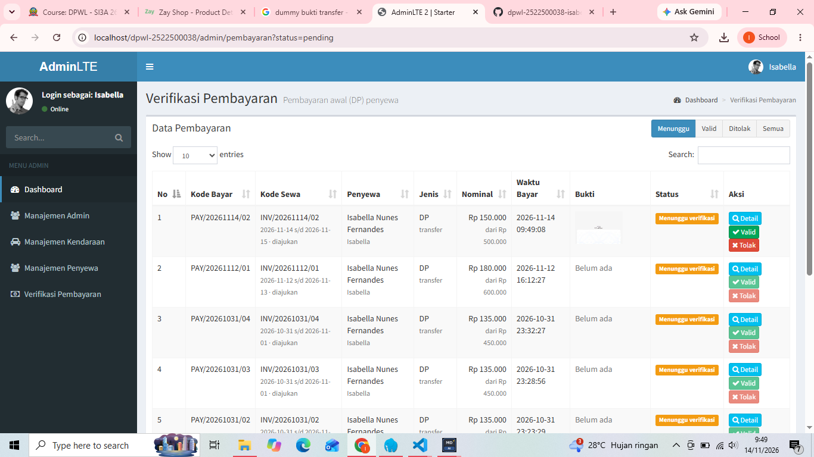
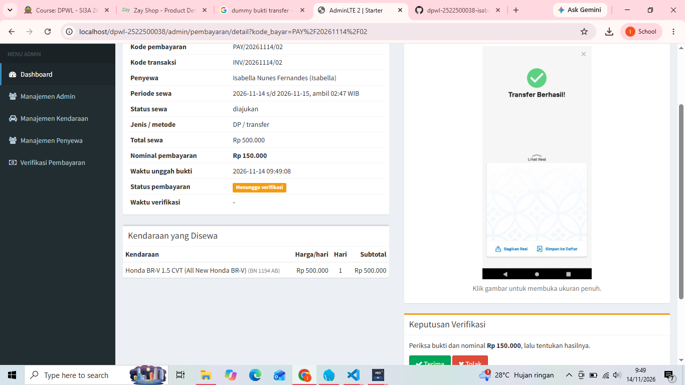
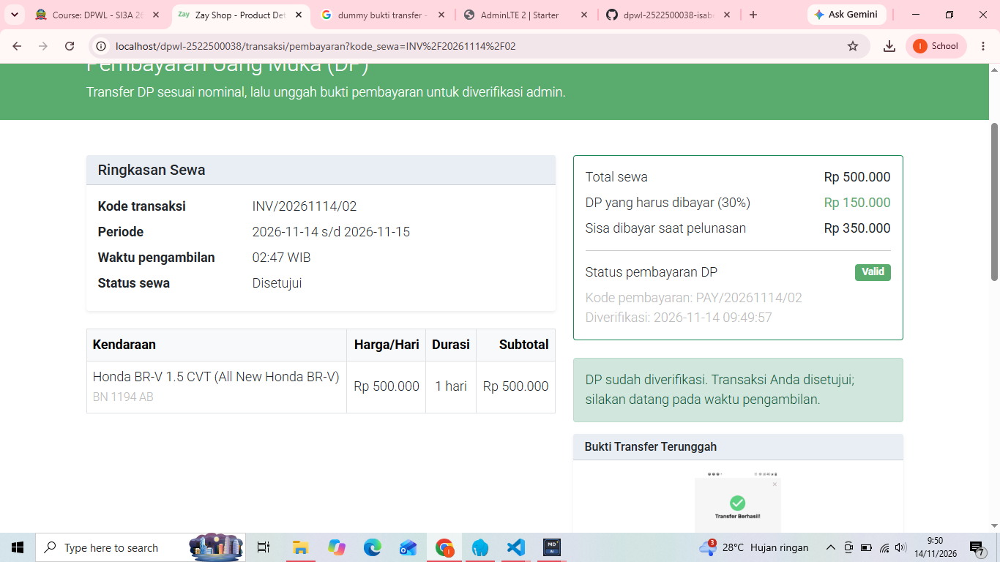
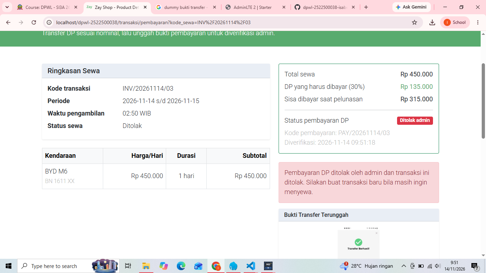

# README P9 — Pembayaran Awal (DP) dan Verifikasi Pembayaran

Lanjutan aplikasi Sistem Informasi Penyewaan Kendaraan (PHP 8.4, homemade MVC, MySQLi, prepared statement) dari P7/P8. Fitur P7/P8 tidak dihapus atau diganti.

## 1. Ringkasan Fitur

**Penyewa**
- Setelah checkout, penyewa diarahkan ke halaman **Pembayaran DP** (`transaksi/pembayaran?kode_sewa=...`).
- Halaman menampilkan rincian transaksi, kode pembayaran, nominal DP 30% (diambil dari `t_bayar.nominal`, bukan dari formulir), metode, dan status.
- Penyewa mengunggah bukti transfer (JPG/PNG/WEBP, maks. 5 MB). `t_bayar.ft_byr` dan `t_bayar.tgl_wkt_byr` diperbarui pada record DP yang sudah dibuat saat checkout (tidak membuat record baru). Status tetap `pending`.
- Menu **Transaksi Saya** (`transaksi/saya`) menampilkan daftar transaksi dan status DP.

**Admin**
- Menu baru **Verifikasi Pembayaran** (`admin/pembayaran`) dengan filter Menunggu / Valid / Ditolak / Semua.
- Halaman **Detail** (`admin/pembayaran/detail?kode_bayar=...`) menampilkan data penyewa, transaksi, kendaraan, nominal, waktu unggah, dan bukti transfer ukuran penuh.
- Admin dapat **Terima** atau **Tolak** (keduanya wajib ada bukti transfer):

| Keputusan | `t_bayar.sttus_byr` | `t_sewa.status_sewa` | `t_bayar.tgl_wkt_ver` |
|---|---|---|---|
| Diterima | `valid` | `disetujui` | waktu verifikasi |
| Ditolak | `invalid` | `ditolak` | waktu verifikasi |

- Kedua tabel diubah dalam satu transaksi database (`begin_transaction` / `commit` / `rollback`) dengan `SELECT ... FOR UPDATE`. Pembayaran yang sudah diverifikasi tidak dapat diproses ulang.

**Keamanan**
- Penyewa harus login; hanya dapat membuka pembayaran dan bukti miliknya (transaksi orang lain → 404, bukti orang lain → 403).
- Admin tidak dapat mengakses proses unggah penyewa; penyewa tidak dapat mengakses menu verifikasi admin.
- Validasi unggah: kode error PHP, ukuran (>0 dan ≤ 5 MB), MIME type lewat `finfo`, dan `getimagesize()`. Nama berkas dibuat aman: `ft_byr_<YmdHis>_<16 hex acak>.<ekstensi dari MIME>`.
- CSRF token pada semua formulir POST; Post-Redirect-Get pada unggah dan verifikasi.
- Folder `uploads/bayar/` dilindungi `.htaccess` (`Require all denied`). Bukti hanya dapat dibuka lewat `transaksi/bukti?kode_bayar=...` setelah pemeriksaan hak akses (admin atau pemilik transaksi).

## 2. Perubahan pada Perbaikan Ini (Revisi Kesesuaian Soal)

| No | Temuan | Perbaikan |
|---|---|---|
| 1 | Bukti disimpan di `uploads/bukti/`, soal meminta `uploads/bayar/` | `folderBukti()` diarahkan ke `uploads/bayar/`; berkas lama dipindahkan; folder sisa `uploads/bukti-pembayaran/` dihapus |
| 2 | Pembayaran ditolak tidak mengubah `t_sewa` | Tolak sekarang `t_bayar = invalid` dan `t_sewa = ditolak`. Fitur unggah ulang setelah ditolak dihapus karena transaksi sudah berstatus ditolak; penyewa perlu membuat transaksi baru |
| 3 | Admin masih bisa menolak pembayaran tanpa bukti | Bukti wajib untuk Terima maupun Tolak (cek di model dan tombol dinonaktifkan di view) |
| 4 | Tidak ada halaman detail verifikasi | Ditambah `admin/pembayaran/detail` (`Pembayaran_controller::detail`, `Transaksi_model::getDetailPembayaran`, view `admin/pembayaran_detail.php`) |
| 5 | Berkas di `uploads/` dapat dibuka langsung tanpa login (aturan `.htaccess` root meneruskan berkas fisik) | Ditambah `uploads/bayar/.htaccess` |
| 6 | Berkas debug `application/cek.php` tertinggal | Dihapus |

Catatan: `uploads/penyewa/` (foto KTP/SIM dari P8) juga belum memiliki `.htaccess`. Tidak diubah di P9 karena di luar lingkup, tetapi disarankan diberi perlindungan yang sama.

## 3. Daftar File yang Ditambah / Diubah

| File | Status | Keterangan |
|---|---|---|
| `application/models/Transaksi_model.php` | diubah | `getTransaksiPenyewa`, `getTransaksiDenganDp`, `simpanBuktiDp` (hanya saat `pending`), `getDaftarPembayaran`, `verifikasiPembayaran` (valid→disetujui, invalid→ditolak, bukti wajib), `getDetailPembayaran`, `getPembayaranUntukBukti` |
| `application/controllers/Transaksi_controller.php` | diubah | `saya`, `pembayaran`, `unggahBukti`, `bukti`; redirect checkout ke halaman pembayaran; folder `uploads/bayar/` |
| `application/controllers/Pembayaran_controller.php` | baru | `index`, `detail`, `verifikasi` (admin) |
| `application/config/routes.php` | diubah | Route P9 |
| `application/views/transaksi/pembayaran.php` | baru | Halaman pembayaran DP penyewa |
| `application/views/transaksi/saya.php` | baru | Daftar transaksi penyewa |
| `application/views/admin/pembayaran_view.php` | baru | Daftar verifikasi admin |
| `application/views/admin/pembayaran_detail.php` | baru | Detail verifikasi admin |
| `application/views/templates/sidebar.php` | diubah | Menu Verifikasi Pembayaran |
| `uploads/bayar/.htaccess` | baru | Menutup akses langsung ke bukti |
| `application/cek.php` | dihapus | Berkas debug |

Struktur database tidak diubah.

## 4. Cara Menjalankan

1. Salin folder ke `C:\laragon\www\<nama-folder>\` lalu sesuaikan `RewriteBase` di `.htaccess` dan `base_url` di `application/config/config.php`.
2. Start Apache dan MySQL di Laragon (PHP 8.4, ekstensi `mysqli` dan `fileinfo` aktif). Pastikan `AllowOverride All` aktif agar `.htaccess` terbaca.
3. Impor `db_dpwl_isabella.sql`.
4. Pastikan folder `uploads/bayar/` dapat ditulis.
5. Login admin di `/auth/login`, login penyewa di `/auth/login-penyewa`.

## 5. Cara Menguji

1. **Penyewa**: login, tambahkan kendaraan ke keranjang, checkout. Aplikasi membuka halaman Pembayaran DP. Periksa `t_bayar`: satu record `dp`, `pending`, `ft_byr` NULL.
2. Unggah bukti valid, lalu periksa `t_bayar.ft_byr`, `tgl_wkt_byr`, status `pending`, dan berkas di `uploads/bayar/`.
3. **Admin**: login, buka Verifikasi Pembayaran, buka Detail, lalu Terima atau Tolak.
4. Periksa `t_bayar` dan `t_sewa` setelah setiap proses (lihat bagian 6).
5. Buka langsung `http://localhost/<folder>/uploads/bayar/<nama-berkas>` — harus ditolak (403).

## 6. Hasil Pengujian Skenario

> Seluruh skenario diuji pada aplikasi yang berjalan di Laragon. Kolom **Mekanisme** menunjukkan bagian kode yang menjamin hasil yang diharapkan.

| No | Skenario | Hasil yang Diharapkan | Mekanisme | Hasil Aktual | Status |
|---|---|---|---|---|---|
| 1 | Penyewa membuka halaman pembayaran setelah checkout | Informasi transaksi dan DP tampil | `pembayaran()` + `getTransaksiDenganDp()` | Halaman pembayaran tampil dengan rincian transaksi, kode pembayaran, DP 30%, dan status. | Berhasil |
| 2 | Penyewa membuka pembayaran milik akun lain | Akses ditolak | Query memakai `user_plg` sesi → 404 | Akses ditolak (404, transaksi tidak ditemukan atau bukan milik akun ini). | Berhasil |
| 3 | Unggah bukti valid | Berkas tersimpan, record diperbarui | `simpanFileBukti()` + `simpanBuktiDp()` | Berkas tersimpan di `uploads/bayar/`, `ft_byr` dan `tgl_wkt_byr` diperbarui, pesan sukses tampil. | Berhasil |
| 4 | Unggah jenis tidak diizinkan (mis. PDF) | Ditolak | Cek MIME `finfo` + `getimagesize` | Berkas ditolak dengan pesan harus berupa gambar JPG, PNG, atau WEBP. | Berhasil |
| 5 | Unggah > 5 MB | Ditolak | Cek `size` dan `UPLOAD_ERR_INI_SIZE` | Berkas ditolak dengan pesan melebihi batas ukuran 5 MB. | Berhasil |
| 6 | Kirim formulir tanpa berkas | Pesan kesalahan | `UPLOAD_ERR_NO_FILE` | Muncul pesan agar memilih foto bukti transfer terlebih dahulu. | Berhasil |
| 7 | Lihat pembayaran setelah unggah | Status tetap `pending` | `simpanBuktiDp()` tidak mengubah `sttus_byr` | Status tetap `pending` (Menunggu verifikasi admin). | Berhasil |
| 8 | Admin membuka daftar verifikasi | Pembayaran pending tampil | `Pembayaran_controller::index` (filter default `pending`) | Daftar pembayaran berstatus pending tampil. | Berhasil |
| 9 | Admin melihat bukti transfer | Bukti dapat diperiksa | Halaman Detail + `transaksi/bukti` | Bukti transfer tampil pada daftar dan halaman Detail, dapat dibuka ukuran penuh. | Berhasil |
| 10 | Admin menerima pembayaran | `valid` + `disetujui` | `verifikasiPembayaran()` dalam transaksi DB | `t_bayar` menjadi `valid`, `tgl_wkt_ver` terisi, `t_sewa` menjadi `disetujui`. | Berhasil |
| 11 | Admin menolak pembayaran | `invalid` + `ditolak` | `verifikasiPembayaran()` dalam transaksi DB | `t_bayar` menjadi `invalid`, `tgl_wkt_ver` terisi, `t_sewa` menjadi `ditolak`. | Berhasil |
| 12 | Admin memverifikasi tanpa bukti | Proses ditolak | Cek `ft_byr` di model; tombol nonaktif | Tombol Terima dan Tolak nonaktif, proses ditolak sistem. | Berhasil |
| 13 | Admin memverifikasi pembayaran yang sudah diproses | Verifikasi berulang ditolak | Cek `sttus_byr <> 'pending'` | Verifikasi ulang ditolak dengan pesan pembayaran sudah diverifikasi. | Berhasil |
| 14 | Penyewa membuka menu verifikasi admin | Akses ditolak | `require_admin_login()` | Akses ditolak, diarahkan ke login admin. | Berhasil |
| 15 | Pengguna belum login membuka halaman pembayaran | Diarahkan ke login | `wajibLoginPenyewa()` | Diarahkan ke halaman login penyewa. | Berhasil |
| 16 | Buka `uploads/bayar/<berkas>` langsung dari browser | Ditolak (403) | `uploads/bayar/.htaccess` | Akses langsung ditolak (403). | Berhasil |
| 17 | Penyewa mengunggah bukti pada transaksi yang sudah ditolak/disetujui | Ditolak | `simpanBuktiDp()` cek `status_sewa` dan `sttus_byr` | Unggahan ditolak, formulir unggah tidak tersedia. | Berhasil |

## 7. Pemeriksaan Konsistensi Data

Setelah setiap skenario, `t_sewa` dan `t_bayar` diperiksa dengan query berikut:

```sql
SELECT s.kode_sewa, s.status_sewa, b.kode_bayar, b.sttus_byr, b.ft_byr, b.tgl_wkt_byr, b.tgl_wkt_ver
FROM t_sewa s JOIN t_bayar b ON b.kode_sewa = s.kode_sewa
WHERE b.jns_byr = 'dp' ORDER BY b.tgl_wkt_byr DESC;
```

Hasil: data konsisten pada semua skenario. Pasangan status yang muncul: `pending` ↔ `diajukan`, `valid` ↔ `disetujui`, `invalid` ↔ `ditolak`.

## 8. Temuan Baseline P7/P8
Seluruh fitur P7 dan P8 (login, katalog, profil, keranjang, checkout, record DP) berfungsi dengan baik sebelum pengembangan P9. Tidak ditemukan galat pada pemeriksaan baseline.


## 9. Dokumentasi Pengujian Real-time
1. **Upload Bukti Pembayaran**
 
2. **Daftar Verifikasi Pembayaran oleh Admin**

3. **Detail Verifikasi Admin**

4. **Pembayaran Diterima**

5. **Pembayaran Ditolak**
